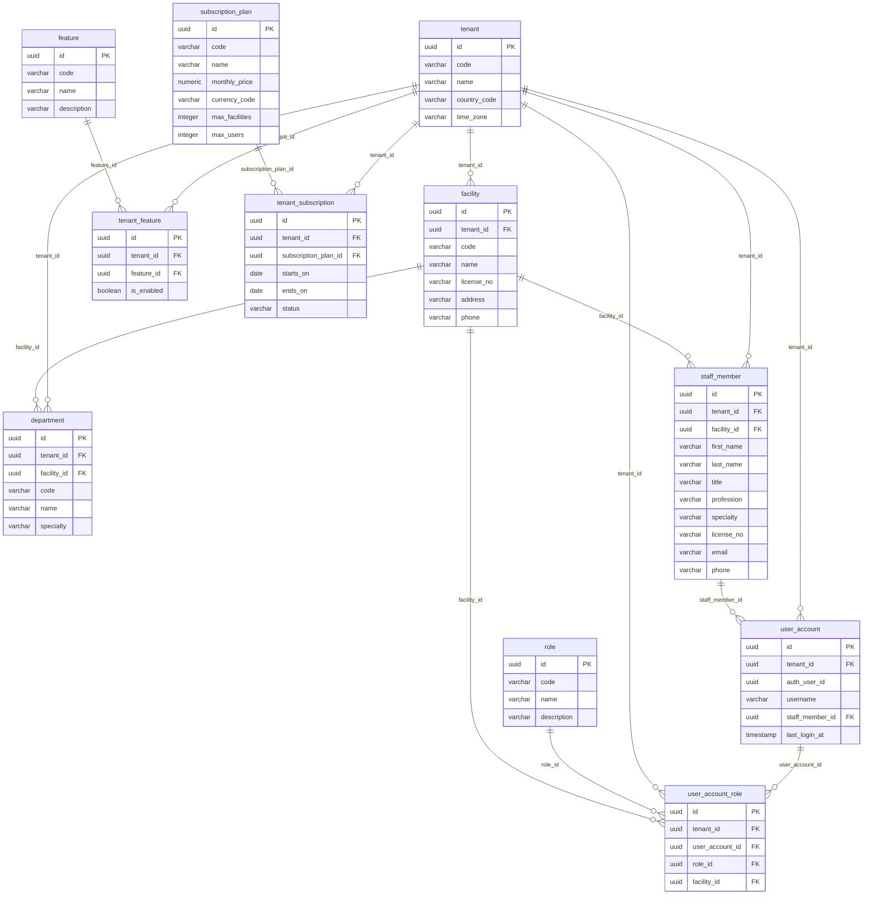
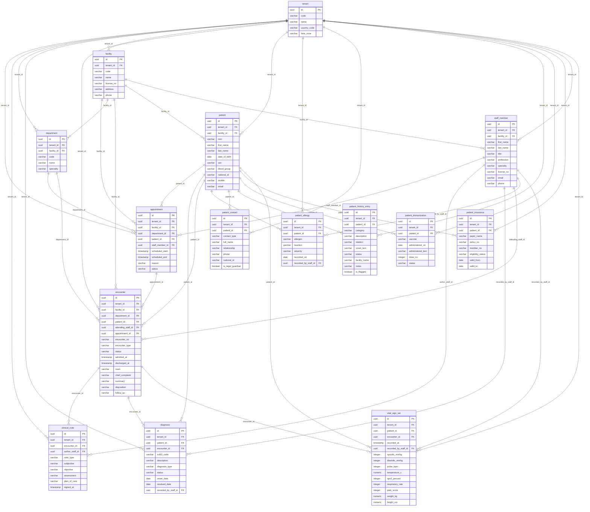
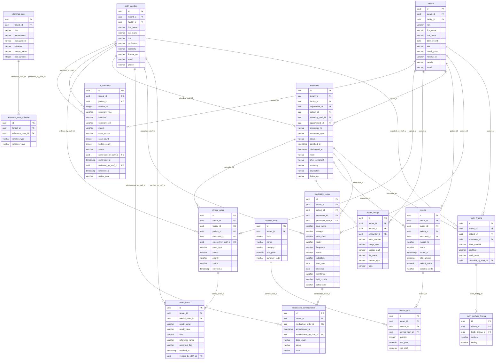

# MediMind EMR — Entity relationship diagram

Generated from the live foreign keys. Audit/soft-delete columns are omitted for readability; every table also has `created_by`, `created_at`, `updated_by`, `updated_at`, `is_active`, `deleted_at`.

## Overview (all tables, relationships only)

```mermaid
erDiagram
    staff_member ||--o{ ai_summary : "generated_by_staff_id"
    patient ||--o{ ai_summary : "patient_id"
    staff_member ||--o{ ai_summary : "reviewed_by_staff_id"
    department ||--o{ appointment : "department_id"
    patient ||--o{ appointment : "patient_id"
    staff_member ||--o{ appointment : "staff_member_id"
    user_account ||--o{ audit_log : "changed_by"
    staff_member ||--o{ clinical_note : "author_staff_id"
    encounter ||--o{ clinical_note : "encounter_id"
    encounter ||--o{ clinical_order : "encounter_id"
    staff_member ||--o{ clinical_order : "ordered_by_staff_id"
    patient ||--o{ clinical_order : "patient_id"
    encounter ||--o{ dental_image : "encounter_id"
    patient ||--o{ dental_image : "patient_id"
    facility ||--o{ department : "facility_id"
    tenant ||--o{ department : "tenant_id"
    encounter ||--o{ diagnosis : "encounter_id"
    patient ||--o{ diagnosis : "patient_id"
    staff_member ||--o{ diagnosis : "recorded_by_staff_id"
    appointment ||--o{ encounter : "appointment_id"
    staff_member ||--o{ encounter : "attending_staff_id"
    department ||--o{ encounter : "department_id"
    patient ||--o{ encounter : "patient_id"
    tenant ||--o{ facility : "tenant_id"
    encounter ||--o{ invoice : "encounter_id"
    patient ||--o{ invoice : "patient_id"
    invoice ||--o{ invoice_line : "invoice_id"
    service_item ||--o{ invoice_line : "service_item_id"
    staff_member ||--o{ medication_administration : "administered_by_staff_id"
    medication_order ||--o{ medication_administration : "medication_order_id"
    encounter ||--o{ medication_order : "encounter_id"
    patient ||--o{ medication_order : "patient_id"
    staff_member ||--o{ medication_order : "prescriber_staff_id"
    clinical_order ||--o{ order_result : "clinical_order_id"
    staff_member ||--o{ order_result : "verified_by_staff_id"
    patient ||--o{ patient_allergy : "patient_id"
    staff_member ||--o{ patient_allergy : "recorded_by_staff_id"
    patient ||--o{ patient_contact : "patient_id"
    patient ||--o{ patient_history_entry : "patient_id"
    patient ||--o{ patient_immunization : "patient_id"
    patient ||--o{ patient_insurance : "patient_id"
    reference_case ||--o{ reference_case_criterion : "reference_case_id"
    feature ||--o{ tenant_feature : "feature_id"
    subscription_plan ||--o{ tenant_subscription : "subscription_plan_id"
    encounter ||--o{ tooth_finding : "encounter_id"
    patient ||--o{ tooth_finding : "patient_id"
    staff_member ||--o{ tooth_finding : "recorded_by_staff_id"
    tooth_finding ||--o{ tooth_surface_finding : "tooth_finding_id"
    staff_member ||--o{ user_account : "staff_member_id"
    role ||--o{ user_account_role : "role_id"
    user_account ||--o{ user_account_role : "user_account_id"
    encounter ||--o{ vital_sign_set : "encounter_id"
    patient ||--o{ vital_sign_set : "patient_id"
    staff_member ||--o{ vital_sign_set : "recorded_by_staff_id"
```

## Organisation, identity & subscription

## Patient, scheduling & encounters

## Orders, medications, dental, AI & billing

## Tenancy rule

Every table except the global catalogues (`role`, `subscription_plan`, `feature`) carries `tenant_id → tenant.id`. Tables that belong to a site also carry `facility_id → facility.id`. Tenant links are drawn in the overview only where they are the sole parent.
